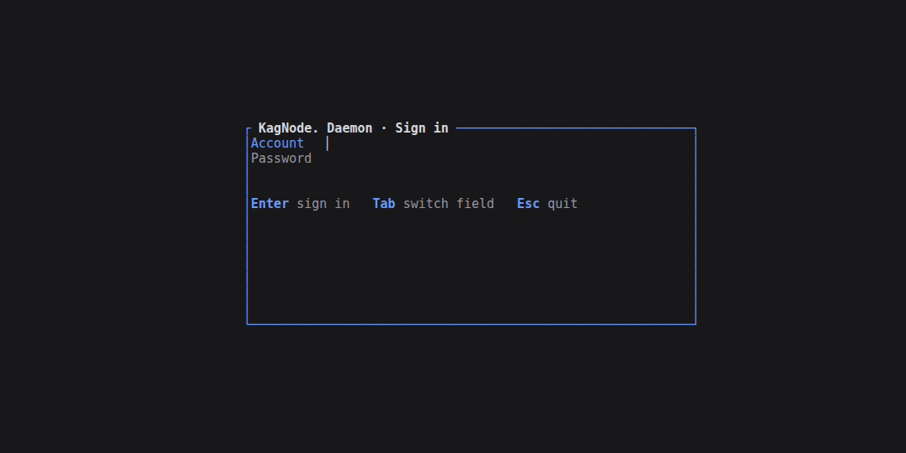
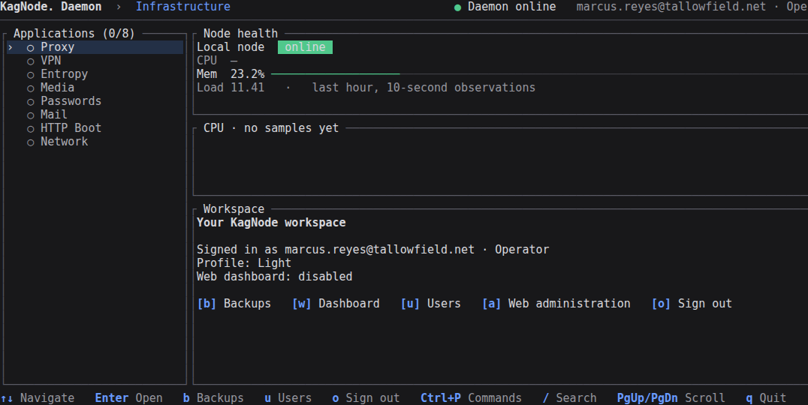
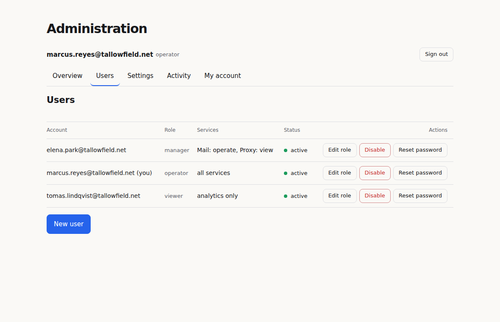
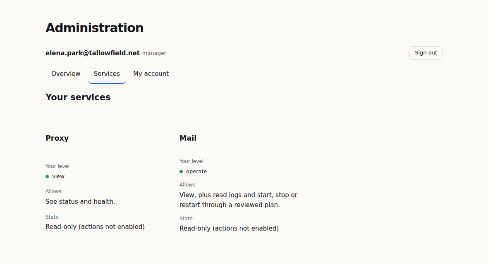

<p align="center"></p>

# KagNode. Daemon

Administrator workspace for KagNode applications: terminal client, optional web dashboard and managed services.

## Overview

`kagnode` signs you in, then shows the screens your role allows. Renamed from `kagnode-cli`; the compatibility releases and the `kagnode` command are unchanged.

| Sign in                                                | Workspace                                                   |
| ------------------------------------------------------ | ----------------------------------------------------------- |
|  |  |
|       |        |

| Administration: Users                       | Manager: Services                                           |
| ------------------------------------------- | ----------------------------------------------------------- |
|  |  |

Accounts and people shown are invented. Merged source, not yet released.

| Role     | Can do                                           |
| -------- | ------------------------------------------------ |
| Operator | Everything, including users and settings         |
| Manager  | Chosen services at view, operate or manage level |
| Viewer   | Read-only server analytics                       |

The Daemon checks the role on every request. Risky changes ask for your password again. Web administration is off until an Operator enables it in the terminal (`a`).

## Release status

**5.0.3** is the coordinated stable compatibility command release. The Rust Daemon (roles, sign-in, terminal, web administration) is merged source only.

|               |                                                                                       |
| ------------- | ------------------------------------------------------------------------------------- |
| Source        | Merged                                                                                |
| Release       | Compatibility 5.0.3 only; no Rust release                                             |
| Deployed      | No                                                                                    |
| Not available | Product controls (logs, boot, Core updates), owner-mode install, separate-user access |

## Features

| Area      | Included                                                       |
| --------- | -------------------------------------------------------------- |
| Accounts  | Argon2 passwords, roles, per-service levels, audit history     |
| Interface | Core web pages and a keyboard/mouse terminal                   |
| Services  | Root-enrolled bindings, reviewed plans, idempotent requests    |
| Backups   | Encrypted database snapshots with restore checks               |
| HA        | Typed declarations with fail-closed checks; no live activation |

## Requirements

Rust 1.88+ to build. Ubuntu 24.04 or Debian 13. The Rust runtime needs no Node.js, Go or Python. The retained compatibility command uses Go and Python helpers.

## Installation and downloads

Take releases only from [GitHub Releases](https://github.com/every-lemon/kagnode-daemon/releases) and verify `SHA256SUMS`.

| Payload            | Formats                                                          |
| ------------------ | ---------------------------------------------------------------- |
| Source and artwork | `.tar.xz`, `.tar.gz`, `.zip`, `.deb`, `.rpm` (source only)       |
| Compatibility CLI  | `.deb`, `.rpm`, `.tar.xz`, `.tar.gz`, `.zip` for amd64 and arm64 |

Source packages do not provision services. See [packaging](docs/PACKAGING.md).

## Usage

```sh
kagnode login
kagnode whoami
kagnode apps list
kagnode apps plan mail --mode native --config /root/mail-config.json --save-plan /root/mail-plan.json
kagnode apps apply mail --plan /root/mail-plan.json
```

See [application setup](docs/INSTALLERS.md) and [account sign-in](docs/ACCOUNT-SYNC.md).

## Configuration and storage

| Item         | Location                             |
| ------------ | ------------------------------------ |
| Credentials  | User XDG config directory, mode 0600 |
| Shared state | `/srv/kagnode`                       |
| Core manager | [docs/CORE.md](docs/CORE.md)         |

## Security

HTTPS and least-privilege accounts for hosted services. No secrets in Git. Installing the command does not qualify managed services. See [security](docs/SECURITY.md).

## Development and testing

```sh
cargo fmt --all --check
cargo clippy --workspace --locked --all-targets -- -D warnings
cargo test --workspace --locked
python3 scripts/repository_check.py
```

## Documentation

|                       |                                                  |
| --------------------- | ------------------------------------------------ |
| Ecosystem and limits  | [docs/ECOSYSTEM.md](docs/ECOSYSTEM.md)           |
| Repository map        | [docs/STRUCTURE.md](docs/STRUCTURE.md)           |
| Packages and releases | [docs/PACKAGING.md](docs/PACKAGING.md)           |
| Verification          | [docs/VERIFICATION.md](docs/VERIFICATION.md)     |
| Rust migration        | [docs/RUST-MIGRATION.md](docs/RUST-MIGRATION.md) |
| Changelog             | [CHANGELOG.md](CHANGELOG.md)                     |

## Licensing

AGPL-3.0-only; see [LICENSE](LICENSE). Artwork keeps its separate permission and brand policy.
