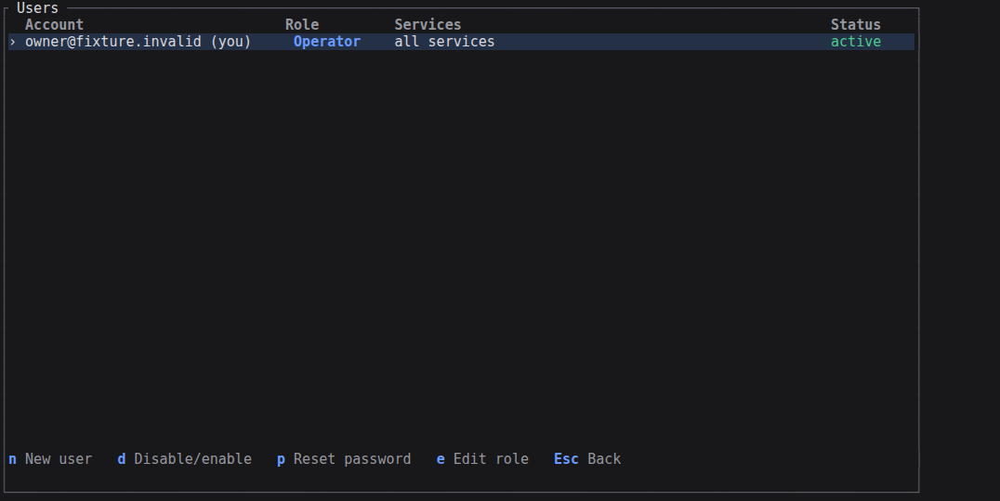
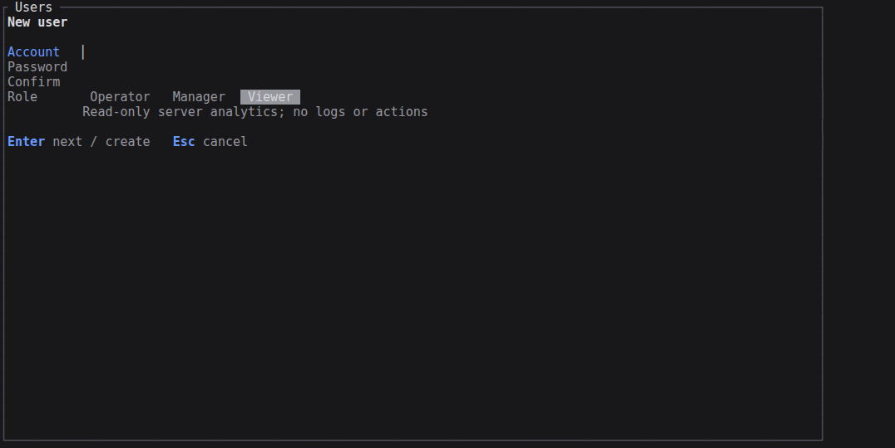

<p align="center"></p>

# KagNode. Daemon

## Overview

An administrator workspace for KagNode applications, with a shared Core dashboard and a Rust terminal interface. The repository was renamed from `kagnode-cli`; retained compatibility releases preserve their existing account and native-data behavior and the `kagnode` command. Adoption by the Rust candidate requires separate migration and installation qualification.

### What it looks like

All screenshots show current source in a temporary test installation with fictional accounts. No real server, account or data appears. They do not establish a released Rust binary, production deployment or native-service qualification.

**Terminal.** `kagnode` asks who you are first, then shows the screens your role allows.

| Sign in                                                                                                     | Workspace                                                                                                      |
| ----------------------------------------------------------------------------------------------------------- | -------------------------------------------------------------------------------------------------------------- |
|            |  |
|  |               |

**Web administration.** An Operator manages accounts; a Manager sees only the services they were given.

| Operator: Users                                                                                  | Manager: Services                                                                                                         |
| ------------------------------------------------------------------------------------------------ | ------------------------------------------------------------------------------------------------------------------------- |
|  |  |

### How accounts and roles work (merged source, not released)

The reviewed roles and authenticated clients are integrated in current source. They have not been published as a new Rust runtime release or deployed over a legacy installation. Check [Release status](#release-status), [migration limits](docs/RUST-MIGRATION.md) and the changelog before relying on them.

1. **First account.** Setup asks whether to protect the Daemon with an Operator password. The protected path creates the first **Operator**. Declining currently stops before provisioning because service-user support for unprotected installation is unfinished. Explicit `init-owner` supports an empty local development store with one implicit Operator and an "unprotected" marker; it cannot downgrade an existing protected store and is not a qualified production installation.
2. **Three roles.** An **Operator** can do everything, including managing users. A **Manager** gets chosen services, each at a level: _view_, _operate_ or _manage_. These levels bound authorization; native health/log/start/stop/boot/Core actions remain unavailable until their adapters are implemented and qualified. A **Viewer** sees read-only server analytics only.
3. **The Daemon decides.** The terminal and the browser are clients. They send your session to the Daemon, which checks your role on every request, so hiding a button is never the only protection.
4. **Risky changes ask again.** Creating users, changing roles, resetting passwords and changing settings each ask for your own password, bound to that exact change, and a result that could not be read is reported as uncertain instead of retried.
5. **Web administration is off by default.** While off, the web page cannot change users or settings. An Operator turns it on from the terminal (`a`). Managed applications are never affected either way.
6. **Limits.** Native product controls (logs, boot, Core updates, backup management) are not switched on yet. Separate-UID admission and lossless security-audit retention remain designs, not deployed controls. People who share the machine's operating-system account are not separated from each other; the security notes explain the boundary.

## Release status

**5.0.3** is the coordinated stable compatibility command release. The **5.0.3 Rust Daemon candidate** adds local administration, Core presentation, terminal folder navigation, reviewed native-operation scaffolding (authenticated product controls remain disabled), encrypted control-database backups and fresh-install profiles. Qualification and migration work is tracked in [the Rust migration matrix](docs/RUST-MIGRATION.md).

No new Rust candidate release or production deployment is established by these source merges. The Rust candidate does not replace an existing CLI installation until compatibility is qualified. Remote node management, live networking, automatic HA and Core Server Offloading remain gated. Saving a cluster declaration is not HA activation. Existing application runtimes and data stay in place.

## Features

- Rust administrator sessions, Argon2 credentials, CSRF protection, revision conflicts and audit history.
- Canonical Core login, sidebar, folder navigation, search, account controls and preferences.
- Keyboard/mouse terminal browsing and scriptable JSON inspection.
- Root-enrolled service bindings, reviewed definition/state hashes, request idempotency and uncertain-operation recovery.
- Light/Production install-profile source and optional web dashboard; owner-mode service installation and existing-runtime adoption remain unqualified.
- Consistent encrypted Daemon database snapshots with restore checks; application data retains separate backup ownership.
- Typed HA declarations and fail-closed promotion preconditions; live cluster activation remains unqualified.
- Retained compatibility CLI source and existing account/installer/update flows during staged Rust replacement.

## Requirements

The Rust candidate requires Rust 1.88 or newer to build. Native setup targets Ubuntu 24.04 and Debian 13; Linux amd64/arm64 qualification is recorded separately. The new Rust server/terminal runtime does not require Node.js, Go or Python. Browser UI remains HTML/CSS/JavaScript. Existing third-party engines keep their own dependencies.

The retained 5.0.3 compatibility command uses Go and Python management helpers, as documented in its release. It stays available until each Rust replacement passes parity and upgrade checks.

## Installation and downloads

Download from [GitHub Releases](https://github.com/every-lemon/kagnode-daemon/releases). Verify `SHA256SUMS` before extracting or installing a package.

| Payload                   | Formats                                      | Support                                     |
| ------------------------- | -------------------------------------------- | ------------------------------------------- |
| Complete source / artwork | `.tar.xz`, `.tar.gz`, `.zip`                 | Named top-level directory; manual setup     |
| Source                    | `.deb`                                       | Source only; does not provision a service   |
| Source                    | `.rpm`                                       | Rocky Linux 10 source payload; manual build |
| Retained compatibility CLI binaries | `.deb`, `.rpm`, `.tar.xz`, `.tar.gz`, `.zip` | amd64 and arm64                             |

Linux arm64 binaries are cross-built; disposable package lifecycle checks run on amd64. Physical/native service qualification remains separate.

Source packages install under `/usr/share/kagnode/`; they do not replace an existing application, migrate data, start services or configure networking. CLI binary packages install /usr/bin/kagnode. See [package details](docs/PACKAGING.md).

## Usage

```sh
kagnode login
kagnode whoami
kagnode setup
kagnode apps list
kagnode apps plan mail --mode native --config /root/mail-config.json --save-plan /root/mail-plan.json
kagnode apps apply mail --plan /root/mail-plan.json
```

See [reviewed application setup](docs/INSTALLERS.md) and [account sign-in](docs/ACCOUNT-SYNC.md) for prerequisites and recovery.

## Configuration and storage

The [KagNode Core manager](docs/CORE.md) verifies signed UI releases and reviewed adapters. This terminal application has no browser-demo server.

Account credentials remain under the user-scoped KagNode XDG configuration directory (0600). Applications share `/srv/kagnode` for releases, configuration and manager state; native projects retain their declared native data locations. Old example data in the XDG data directory is retained but no longer distributed or served.

## Security

Use HTTPS and least-privilege accounts for hosted services. Keep secrets and user data out of Git. Managed application/native-service capabilities are qualified separately; installing the CLI does not qualify or automatically deploy them. See [security guidance](docs/SECURITY.md).

## Development and testing

```sh
cargo fmt --all --check
cargo clippy --workspace --locked --all-targets -- -D warnings
cargo test --workspace --locked
go test ./...
go vet ./...
python3 -m unittest discover -s tests -p 'test_*.py'
python3 tests/tui_pty.py
python3 scripts/repository_check.py
python3 scripts/format_source.py --check
python3 scripts/release.py --output dist/packages
```

Install the formatting dependencies from `requirements-format.txt`. Package building additionally needs `dpkg-deb`, `rpmbuild`, XZ support and, for CLI binaries, Go. Read [the repository map](docs/STRUCTURE.md) before editing generated files.

## Documentation

- [Ecosystem setup, update adapters and current limitations](docs/ECOSYSTEM.md)

- [Repository structure](docs/STRUCTURE.md)
- [Historical operations](docs/OPERATIONS.md)
- [Packages and release process](docs/PACKAGING.md)
- [Verification and limits](docs/VERIFICATION.md)
- [KagNode Account linking](docs/ACCOUNT-SYNC.md)
- [Changelog](CHANGELOG.md)

## Licensing

See [LICENSE](LICENSE) and retained third-party notices. KagNode artwork retains its separate permission and brand policy; the application uses AGPL-3.0-only.
